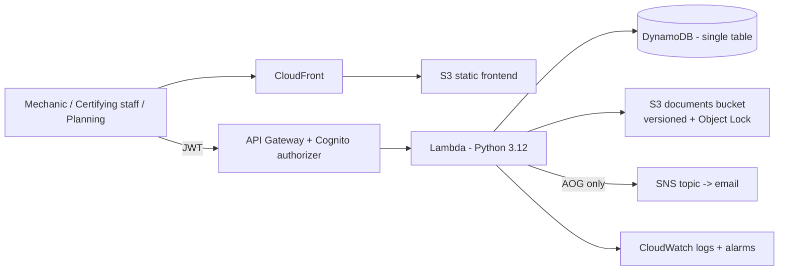

# TechLog Cloud — Design

**One line:** A serverless digital aircraft technical log: raise, defer, rectify and close defects with a Part 145-style immutable audit trail, visible live to planning/CAMO.

## Why this design

| Real-world requirement | Design decision |
|---|---|
| A defect record may never be silently edited or deleted (Part 145 record keeping) | Every change appends a `HISTORY` item; the defect item is never overwritten without a history entry; S3 attachments bucket has Versioning + Object Lock |
| Planning must see fleet status live, not when the aircraft lands | Single fleet-board query via a GSI on `status` |
| Line stations work at 03:00 with gloves on | Three-field minimum to raise a defect (tail, ATA, description); everything else optional |
| An AOG defect must reach a human immediately | SNS notification fired on creation when `category = AOG` |
| Demo must cost ~nothing | Serverless only: Lambda + DynamoDB on-demand + S3; no VPC, no NAT, no EC2 |
| SA employer relevance | Deployed to **af-south-1 (Cape Town)** — POPIA data-residency story |

## Architecture



## DynamoDB single-table design

Table: `TechLogTable` (on-demand, Point-in-Time Recovery on)

| Item | PK | SK | GSI1PK | GSI1SK | Notes |
|---|---|---|---|---|---|
| Defect | `DEFECT#<uuid>` | `META` | `STATUS#<status>` | `<createdAt>#<uuid>` | Current state of the defect |
| History entry | `DEFECT#<uuid>` | `HISTORY#<iso-ts>#<uuid>` | — | — | Append-only: CREATED / DEFERRED / RECTIFIED / REOPENED / CLOSED / PHOTO_ADDED |
| Photo metadata | `DEFECT#<uuid>` | `PHOTO#<uuid>` | — | — | S3 key, content type, uploaded-by |

Access patterns:
1. Get defect + full history → `PK = DEFECT#<id>` (one Query, includes META, HISTORY, PHOTO items)
2. Fleet board → GSI1 Query `GSI1PK = STATUS#OPEN` (also DEFERRED / AOG view via status)
3. Log page per tail → GSI2? Not in MVP: fleet is synthetic/small; log page uses a Scan with filter on `tail` — documented as a known MVP trade-off, with the production fix (GSI on tail) noted in README.

## Defect fields

`defectId, tail, fleetType (B737-800|A320), ataChapter (2-digit), station (FAOR, FACT, FALE…), description, category (AOG|DEFERRAL|CABIN|OBSERVATION), status (OPEN|DEFERRED|RECTIFIED|CLOSED), melRef (required when DEFERRED), raisedBy, createdAt, updatedAt, closedBy, rectificationNote (required when RECTIFIED)`

## Workflow rules (enforced in `logic.py`, unit-tested)

```
OPEN ──defer (melRef required)──▶ DEFERRED ──rectify──▶ RECTIFIED ──close──▶ CLOSED
OPEN ──rectify (note required)──▶ RECTIFIED
DEFERRED ──close──✗ (must rectify first)
CLOSED ──reopen (reason required)──▶ OPEN
Any other transition ──▶ 409 error
```

## API

| Method | Path | Auth role | Purpose |
|---|---|---|---|
| POST | `/defects` | Mechanic, Certifying | Raise defect (fires SNS if AOG) |
| GET | `/defects?status=OPEN` | Any | Fleet board list |
| GET | `/defects/{id}` | Any | Defect + audit history |
| PATCH | `/defects/{id}/status` | Certifying | defer / rectify / close / reopen |
| POST | `/defects/{id}/photo-url` | Mechanic, Certifying | S3 pre-signed PUT URL |
| GET | `/tails/{tail}/logpage` | Any | All defects for a tail (log page view) |

Auth: Cognito user pool, groups `Mechanic` and `Certifying`. API Gateway Cognito authorizer validates the JWT; the Lambda reads `groups` from claims and enforces role rules in code (defence in depth, and it demos in SAA answers).

## Non-goals (MVP)

No real airline data. No offline sync. No e-signature (noted as the production requirement — Part 145 electronic records need attributable signatures; Cognito identity + append-only history is the demo-level answer, stated honestly in README).
